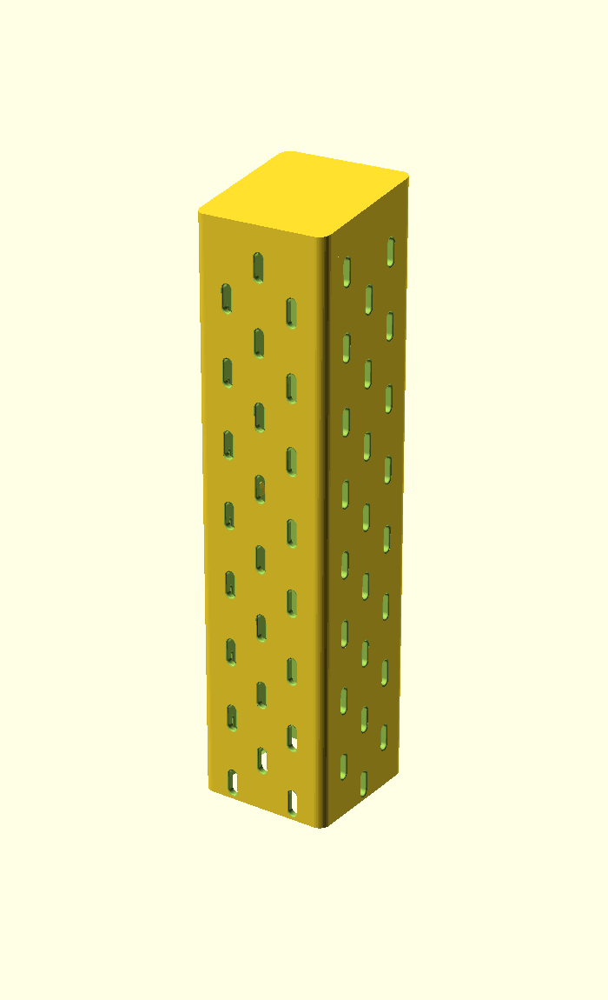
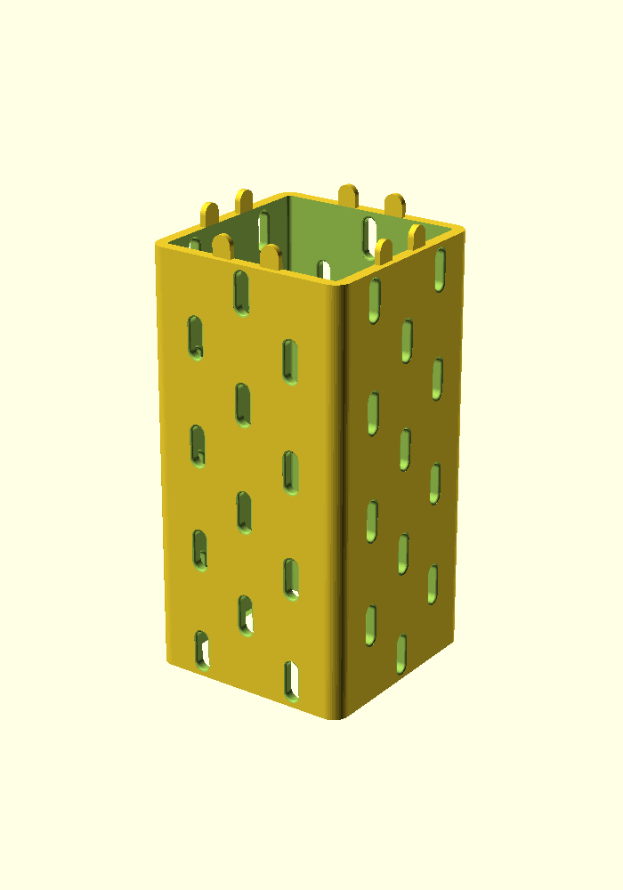
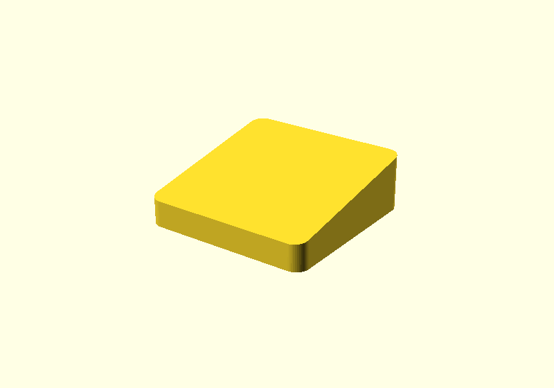

# Parametric Skadis Tower

A four-sided hollow tower whose walls carry the IKEA Skadis peg pattern, so standard
Skadis accessories hook onto every face. Set the outside dimensions and the pattern
lays itself out. Segments stack, and a tilted cap turns a stack into a speaker riser.

Written in OpenSCAD, driven entirely from the Customizer.

## Parts

Pick one with the `part` parameter at the top of the Customizer.

| `part` | What it is |
| --- | --- |
| `tower` | A tower segment. Skadis slots on all four faces, tabs on top, pockets underneath. |
| `cap` | A solid lid with no slots and a tilted top face, for closing off a stack. |

 

Both parts live in one file on purpose. They share every dimension that has to match —
wall thickness, tab size, tab positions — so the cap's pockets cannot drift out of sync
with the tower's tabs the first time you change a tab setting.

## Quick start

1. Open `skadis_tower.scad` in OpenSCAD.
2. Open the Customizer (`Window > Customizer`).
3. Set `width`, `depth` and `height`. Keep `height` a whole multiple of `grid` (20 mm) —
   the console tells you if it isn't, and suggests the nearest good values.
4. `F5` to preview, `F6` to render, then export STL.

The console reports the resulting layout every time: slot counts, minimum sizes at your
settings, material left at the ends, and whether the height stacks cleanly.

## Parameters

### Size

| Parameter | Default | Notes |
| --- | --- | --- |
| `width`, `depth` | 80 | Outside dimensions in mm. |
| `height` | 160 | One segment. Keep it a multiple of `grid`. |
| `corner_radius` | 6 | 0 gives sharp corners. |
| `wall` | 4.5 | See [Wall thickness](#wall-thickness). |

### Stacking

| Parameter | Default | Notes |
| --- | --- | --- |
| `stackable` | true | Tabs on top. Turn it **off** for the topmost segment to get a flat top. Pockets underneath are cut either way, so the piece still seats on whatever is below it. |
| `tabs_per_wall` | 2 | |
| `tab_width` | 8 | Also sets the dome radius (half this). |
| `tab_height` | 8 | How far a tab stands proud. |
| `tab_thickness` | 2.5 | Through the wall. Deliberately independent of `wall`. |
| `tab_clearance` | 0.25 | Raise for a looser fit. |

### Skadis pattern

| Parameter | Default | Notes |
| --- | --- | --- |
| `slot_width` | 5 | The IKEA dimension. See [Slot fit](#slot-fit) before changing it. |
| `slot_height` | 15 | The IKEA dimension. |
| `grid` | 20 | Pattern pitch. The IKEA board is 20. |
| `slot_fit` | 0.2 | Printing allowance on the slot **width** only. |
| `slot_fillet` | 0.8 | Rounds each slot opening, inside and out. |
| `alternate_corners` | true | Staggers the pattern where two faces meet. |
| `edge_margin` | 4 | Minimum material between a slot and a rounded corner. |

### Cap

| Parameter | Default | Notes |
| --- | --- | --- |
| `cap_tilt` | 10 | Degrees from horizontal. 0 gives a plain flat lid. |
| `cap_tilt_dir` | 0 | Which edge is the high one, as a compass direction. |
| `cap_roof` | 4 | Material over the pockets at the low edge. Sets the cap's thickness. |

## Printing

Print both parts standing as modeled. **Neither needs supports.**

The tower is an open tube, so there is nothing to bridge. The only overhangs are the tab
pockets in the underside, and those are arches — the tabs are domed and the pockets are
the same outline grown by the clearance, so the pocket roof self-supports.

The cap is modeled solid on purpose. Under a speaker you want mass and stiffness, not a
thin-walled box that can drum, and leaving it solid hands the weight/material trade to
your slicer's infill setting. Its large flat bottom goes straight on the plate and the
tilted face points up, so again, no supports.

### A note on render times

Each slot is a filleted cut, and a tower has a lot of slots, so `F6` is slow on older
OpenSCAD builds that only ship the CGAL backend. Three things help:

- **Use a recent OpenSCAD.** Releases from 2023 onward include the Manifold backend
  (`Preferences > Advanced > 3D rendering engine`), which is far faster than CGAL on
  models like this one. This is by far the biggest win.
- **Stay in `F5` while you work.** Preview costs about a second and still evaluates every
  assertion and prints the full console report. You only need `F6` to export.
- **Drop `fillet_steps`** (in the Hidden section) if you are stuck on CGAL. It sets how
  many slices approximate each fillet, and render time scales with it almost linearly.

Measured on OpenSCAD 2021.01, CGAL, an 80 × 152 × 80 tower:

| `fillet_steps` | Render |
| --- | --- |
| 6 (default) | 199 s |
| 3 | 110 s |
| 1 | 62 s |

At the default 0.8 mm fillet, 3 slices is hard to tell from 6. Note that 1 slice is a
straight taper rather than a fillet, so it changes the shape of the opening.

## How it works

### The pattern is a checkerboard

A Skadis board is usually described as rows 40 mm apart with alternate rows offset by
20 mm. It is simpler to treat it as a **20 mm square grid with a slot wherever
`(column + row)` is even**. That reproduces the real spacing exactly, and it turns
auto-filling a face into a question of how many grid cells fit.

### Stacking keeps the spacing

For a stack to read as one continuous panel rather than as segments, the gap across a
joint has to equal the gap everywhere else. That means the bottom margin plus the top
margin must come to one full pitch — so each is `grid / 2`, and `height` has to be a
whole number of pitches. The console warns you when it isn't.

A consequence: the lowest row of slots shares the bottom of the tower with the tabs. So
tabs are snapped onto the half-pitch line midway between two slot columns, where they
clear the slots with room to spare. An assertion checks this rather than trusting it.

### Fillets, not chamfers

Each slot opening is blended into the face with a true concave fillet — an arc tangent to
both surfaces — approximated by a stack of hulled slices. The lead-in is what actually
makes a hook easy to start into a slot; you don't have to line it up precisely.

### Tabs are domed so pockets don't need support

The support problem in a stacking joint is never the tab, it's the **pocket** — a
horizontal roof in the underside of the part above. Doming the tab turns that roof into
an arch. The pocket is the tab's outline grown by `tab_clearance`, which puts the two cap
circles concentric, so the clearance is uniform all the way round.

A tab occupies the inner part of the wall only. The outer `wall - tab_thickness` stays
solid, so the joint is invisible from outside.

### Wall thickness

An IKEA Skadis board is 5 mm and hooks are moulded to snap over exactly that. Matching it
is the obvious choice but not the best one here, for two reasons specific to a tower:

1. **Stiffness.** A Skadis board is a wide unsupported panel that flexes slightly as you
   work a hook on or off. A tower wall is a short span tied into two corners at each end,
   so it is far stiffer. None of that give is available, and a hook that is merely snug on
   a real board binds here.
2. **Tolerance stacks the wrong way.** A nominal 5 mm printed wall usually measures a
   little over, so the fit goes from snug to tight rather than from snug to loose.

Hence the 4.5 mm default. Below about 4 mm accessories start to rock noticeably.
`tab_thickness` is independent of `wall` so that tuning this for hook feel does not
quietly weaken the stacking joint.

### Slot fit

`slot_fit` is a **compensation, not a looseness knob**, which is why it is separate from
`slot_width`.

The slot is an interface dimension — accessories are moulded against 5 × 15 — and a snug
width is what stops a loaded hook tilting in its slot. Going deliberately oversize makes
hooks easy to insert *and* easy to shake loose.

But FDM holes come out undersize in the wall plane, because extrusion overlap on the
inside of a curve eats a tenth or two. A nominal 5 mm slot often measures 4.8. `slot_fit`
adds that back, so the printed slot measures what you asked for. Measure one with calipers
and tune.

It is applied to the width only. Z lands where it is told, and the slot roof is an arch,
so there is nothing to compensate for in that direction — and widening the height would
eat into the material left at the ends of each segment for no benefit.

## Credits

By [Aaron Breckenridge](https://www.printables.com/@breckenedge). An OpenSCAD rewrite of
[Skadis Pegboard Tower](https://www.printables.com/model/1502186-skadis-pegboard-tower),
originally modeled in Autodesk Fusion.

SKÅDIS is a trademark of Inter IKEA Systems B.V. This project is not affiliated with or
endorsed by IKEA.
