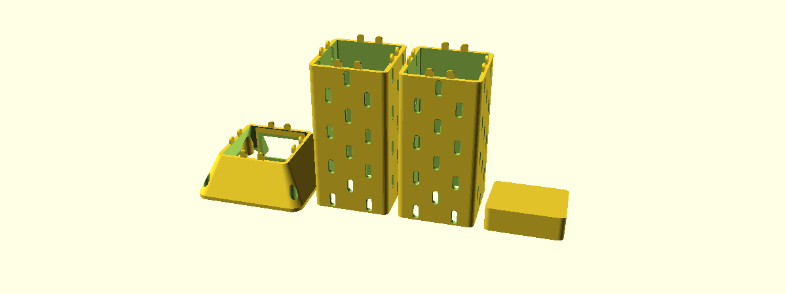
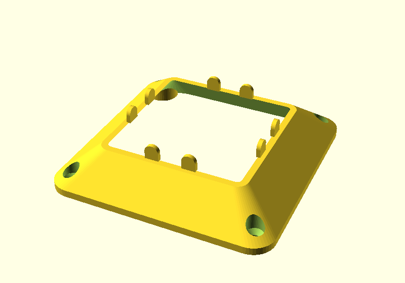
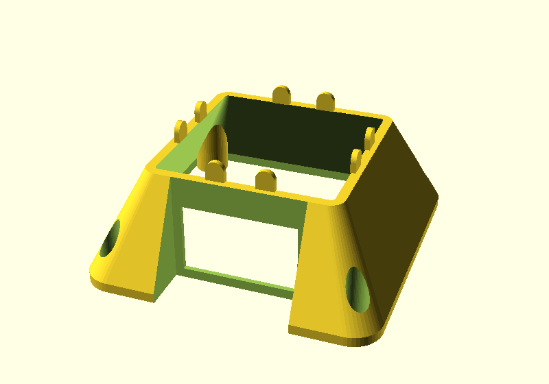

# Parametric Skadis Tower

A four-sided hollow tower whose walls carry the IKEA Skadis peg pattern, so standard
Skadis accessories hook onto every face. Set the outside dimensions and the pattern
lays itself out. Segments stack, a tilted cap turns a stack into a speaker riser, and a
wide, tapered base keeps it from tipping, can be screwed down, and can take a power inlet
so mains wiring runs up the hollow core.

Written in OpenSCAD, driven entirely from the Customizer.


## Parts

Choose what to render in the Parts section at the top of the Customizer. Turn on several
pieces to get a whole stack in one run.

| Parameter | Default | What it is |
| --- | --- | --- |
| `make_base` | false | A hollow footing with tabs on top for the lowest segment. Wider than the tower, optionally tapered, with optional screw holes and an optional power inlet. |
| `towers` | 1 | How many tower segments. Skadis slots on all four faces, tabs on top, pockets underneath. 0 leaves the tower out. |
| `make_cap` | false | A solid lid with no slots and a tilted top face, for closing off a stack. |
| `layout` | print | `print` sets the pieces side by side, each standing the way it prints, `layout_gap` (10 mm) apart, to print separately and stack. `fused` stacks them and joins them into one solid, to print the whole tower in one go. `assembled` stacks them as they go together, so you can see the whole thing; the tabs sit loose in their pockets, so don't print from it. |

In a run with several segments, every segment except the top one gets tabs. The top one
gets tabs when the cap is on, or when `stackable` is on. For example, `make_base`,
`towers = 3` and `make_cap` give you a base, three segments and a cap in one file, ready
to slice. If a slicer imports them as one object, use its split-to-objects command.

### One-piece towers

With `layout = fused`, the run prints as a single solid instead: the pieces are stacked
and the joints between them are left out, so there are no tabs, pockets or seams inside
the tower. The slot pattern carries straight on across where the joints would be, as
long as `height` is a whole multiple of `grid`. The ends of the run keep their joints —
pockets underneath if there's no base, tabs on top if there's no cap and `stackable` is
on — so a fused tower still stacks with separately printed pieces.

Two things to check before you slice. The whole height has to fit your printer; the
console reports it. And with the cap fused on, its flat underside spans the tower's open
core as a bridge (71 mm at the default size, also reported). Most printers bridge
that fine with cooling up, but if yours doesn't, print the cap separately.



  

All the parts live in one file on purpose. They share every dimension that has to match —
wall thickness, tab size, tab positions — so the cap's pockets and the base's tabs cannot
drift out of sync with the tower the first time you change a tab setting.

## Quick start

1. Open `skadis_tower.scad` in OpenSCAD.
2. Open the Customizer (`Window > Customizer`).
3. Set `width`, `depth` and `height`. Keep `height` a whole multiple of `grid` (20 mm) —
   the console tells you if it isn't, and suggests the nearest good values.
4. Choose the pieces under Parts. Set `layout = assembled` to check how the stack looks,
   then set it to `print` (separate pieces) or `fused` (one piece) before you export.
5. `F5` to preview, `F6` to render, then export STL.

The console reports the resulting layout every time: slot counts, minimum sizes at your
settings, material left at the ends, and whether the height stacks cleanly.

## Parameters

### Size

| Parameter | Default | Notes |
| --- | --- | --- |
| `width`, `depth` | 80 | Outside dimensions in mm. |
| `height` | 160 | One segment. Keep it a multiple of `grid`. |
| `corner_radius` | 6 | 0 gives sharp corners. |
| `wall` | 4.5 | See [Wall thickness](#wall-thickness). |

### Stacking

| Parameter | Default | Notes |
| --- | --- | --- |
| `stackable` | true | Tabs on top of the topmost segment. Turn it **off** to get a flat top. Lower segments in a run always get tabs, and the cap forces them on. Pockets underneath are cut either way, so every piece seats on whatever is below it. |
| `tabs_per_wall` | 2 | |
| `tab_width` | 8 | Also sets the dome radius (half this). |
| `tab_height` | 8 | How far a tab stands proud. |
| `tab_thickness` | 2.5 | Through the wall. Deliberately independent of `wall`. |
| `tab_clearance` | 0.25 | Raise for a looser fit. |

### Skadis pattern

| Parameter | Default | Notes |
| --- | --- | --- |
| `slot_width` | 5 | The IKEA dimension. See [Slot fit](#slot-fit) before changing it. |
| `slot_height` | 15 | The IKEA dimension. |
| `grid` | 20 | Pattern pitch. The IKEA board is 20. |
| `slot_fit` | 0.2 | Printing allowance on the slot **width** only. |
| `slot_fillet` | 0.8 | Rounds each slot opening, inside and out. |
| `alternate_corners` | true | Staggers the pattern where two faces meet. |
| `slots_front`, `slots_back`, `slots_left`, `slots_right` | true, false, true, true | Which faces carry the Skadis pattern. The back is off by default, for a tower that stands against a wall. Turn any face on or off. Front is -Y; back is +Y, the side the base's power inlet is on. |
| `edge_margin` | 4 | Minimum material between a slot and a rounded corner. |

### Cap

| Parameter | Default | Notes |
| --- | --- | --- |
| `cap_tilt` | 10 | Degrees from horizontal. 0 gives a plain flat lid. |
| `cap_tilt_dir` | 180 | Which edge is the high one: 0 back (+Y), 90 left (-X), 180 front (-Y), 270 right (+X). The front default tips a speaker back toward you. |
| `cap_roof` | 4 | Material over the pockets at the low edge. Sets the cap's thickness. |
| `cap_open` | false | Opens the middle, leaving a collar: the tower's walls cut off at the tilt. The speaker sits on a slanted rim, and cables come straight up the core. |

### Base

| Parameter | Default | Notes |
| --- | --- | --- |
| `base_offset_width`, `base_offset_depth` | 20, 20 | Flange on each side of the tower in mm, in X and Y. The footprint at the floor is the tower's outline grown by these, so it follows `width`/`depth` and is never narrower than the tower: 80 mm + 2 × 20 = 120 mm at the defaults. The flange resists tipping. |
| `base_height` | 20 | Height in mm, not counting the tabs on top. |
| `base_corner_radius` | 12 | Corner radius of the footprint at the floor. |
| `base_taper` | true | Slopes the sides from the footprint in to the tower's outline, so the base flows into the tower. Off gives a straight-sided block. |
| `base_foot` | 4 | Straight section at the bottom before the taper starts, so the edge isn't a knife edge. |
| `base_hollow` | true | Hollow walls that open up into the tower's core, so wires can run up the middle. Off gives a solid base: all ballast. |
| `base_wall` | 3 | Wall thickness of a hollow base. The walls thicken toward the top, where they meet the tower wall. |
| `base_floor` | 0 | Floor thickness of a hollow base. 0 leaves the bottom open, so the base is just walls: lighter, quicker to print, and wires can come in from below too. |

### Base screw holes

| Parameter | Default | Notes |
| --- | --- | --- |
| `base_screws` | 4 | 0, 2 (diagonal corners) or 4. |
| `base_screw_position` | outside | `outside`: in the flange, reachable with the tower in place. `inside`: under the tower's hollow core, hidden once the tower is on, so screw the base down first. |
| `base_screw_d` | 4.5 | Shank clearance hole. 4.5 suits a #8 / 4 mm wood screw. |
| `base_screw_head` | countersunk | `countersunk` (90° cone, flat-head screws) or `counterbore` (flat recess, pan-head or cap screws). |
| `base_screw_head_d` | 9 | Head diameter plus a little clearance. |
| `base_screw_seat` | 4 | Height above the floor where the head seats: the material the screw clamps. The recess above runs clear to the top surface. |

Outside holes sit midway across the flange. If they would run under the tower or hang off
a tapered edge, the render stops with a message that says what to change. In a hollow
base, outside holes pass through solid columns from the bottom to the top surface. Inside
holes seat on solid pads, each webbed out to its corner of the wall, so they work with no floor.

### Base power inlet

A cutout in the back (+Y) of the base for a snap-in IEC C14 power inlet: the common
3-in-1 module with a power socket, fuse drawer and rocker switch. Mains comes in at the base, and
the wires run up through the hollow core.



The inlet is recessed. An alcove is cut down through the back of the base, so the inlet
sits flush with the tower's back face instead of the base's outer edge. The plug then
stands out less, and that face still lines up with the tower above it. The alcove needs
the flat part of the tower's back face to be wide enough. With the default 6 mm
`corner_radius`, the tower has to be at least 67 mm wide.

The defaults are sized for this module:
[DEVMO 3D Printer Power Switch, 10A inlet module with 250V fuse and switch](https://www.amazon.com/dp/B0899ZHDNP)
(Amazon B0899ZHDNP, sold as a 2-pack). The listing doesn't give dimensions. These numbers
come from datasheets for the same generic module, which put the cutout at 47.1–47.2 ×
28.1–28.3 mm and the body at about 50 × 31 mm. **Measure yours with calipers before
printing**, and adjust the cutout first.

| Parameter | Default | Notes |
| --- | --- | --- |
| `base_inlet` | false | Turn on to cut the inlet. Needs `base_hollow` and a taller base, about 40 mm (39.5 at the defaults). The console gives the exact minimum. |
| `base_inlet_w`, `base_inlet_h` | 47.5, 28.5 | Panel cutout. |
| `base_inlet_flange_w`, `base_inlet_flange_h` | 50.5, 31.5 | The module's front flange. It sits on the back wall of the alcove. |
| `base_inlet_alcove_gap` | 2 | Space between the flange and each side of the alcove. |
| `base_inlet_depth` | 35 | How far the module reaches behind the panel, terminals included. The bay behind the cutout is carved this deep. |
| `base_inlet_panel` | 2 | Wall thickness around the cutout. Snap-in clips are made for thin sheet panels, so the wall is thinned to this from inside. Use a thinner panel if the clips don't catch, or a thicker one if the module rattles. |
| `base_inlet_clip_room` | 4 | Clearance around the cutout behind the panel, so the clips can spring open. |

The inlet's terminals carry mains voltage. Use crimped, insulated spade connectors with
heat-shrink over them, ground the earth pin, and fit the fuse rating your load needs. If
you aren't comfortable wiring mains, have someone who is do it.

## Printing

Print every part standing as modeled. **None of them needs supports.** (A fused tower with
the cap on has one bridge, under the cap; see [One-piece towers](#one-piece-towers).)

The tower is an open tube, so there is nothing to bridge. The only overhangs are the tab
pockets in the underside, and those are arches — the tabs are domed and the pockets are
the same outline grown by the clearance, so the pocket roof self-supports.

The cap is modeled solid on purpose. Under a speaker you want mass and stiffness, not a
thin-walled box that can drum, and leaving it solid hands the weight/material trade to
your slicer's infill setting. Its large flat bottom goes straight on the plate and the
tilted face points up, so again, no supports.

The base is hollow by default, so there's room for wiring. The cavity's roof is held to 45
degrees: it is clipped to a pyramid that grows out and down from the tower's core
opening. That way it prints without supports. The outer taper slopes inward going up,
the tabs stand free, and every screw recess opens upward. The inlet alcove has straight
sides and is open at the top, so it has no roof to support either. If you'd rather have the weight than the cavity, set
`base_hollow = false` for a solid base. Weight low down is what keeps a tall stack
upright.

### A note on render times

Each slot is a filleted cut, and a tower has a lot of slots, so `F6` is slow on older
OpenSCAD builds that only ship the CGAL backend. Three things help:

- **Use a recent OpenSCAD.** Releases from 2023 onward include the Manifold backend
  (`Preferences > Advanced > 3D rendering engine`), which is far faster than CGAL on
  models like this one. This is by far the biggest win.
- **Stay in `F5` while you work.** Preview costs about a second and still evaluates every
  assertion and prints the full console report. You only need `F6` to export.
- **Drop `fillet_steps`** (in the Hidden section) if you are stuck on CGAL. It sets how
  many slices approximate each fillet, and render time scales with it almost linearly.

Measured on OpenSCAD 2021.01, CGAL, an 80 × 152 × 80 tower:

| `fillet_steps` | Render |
| --- | --- |
| 6 (default) | 199 s |
| 3 | 110 s |
| 1 | 62 s |

At the default 0.8 mm fillet, 3 slices is hard to tell from 6. Note that 1 slice is a
straight taper rather than a fillet, so it changes the shape of the opening.

## How it works

### The pattern is a checkerboard

A Skadis board is usually described as rows 40 mm apart with alternate rows offset by
20 mm. It is simpler to treat it as a **20 mm square grid with a slot wherever
`(column + row)` is even**. That reproduces the real spacing exactly, and it turns
auto-filling a face into a question of how many grid cells fit.

### Stacking keeps the spacing

For a stack to read as one continuous panel rather than as segments, the gap across a
joint has to equal the gap everywhere else. That means the bottom margin plus the top
margin must come to one full pitch — so each is `grid / 2`, and `height` has to be a
whole number of pitches. The console warns you when it isn't.

A consequence: the lowest row of slots shares the bottom of the tower with the tabs. So
tabs are snapped onto the half-pitch line midway between two slot columns, where they
clear the slots with room to spare. An assertion checks this rather than trusting it.

### Fillets, not chamfers

Each slot opening is blended into the face with a true concave fillet — an arc tangent to
both surfaces — approximated by a stack of hulled slices. The lead-in is what actually
makes a hook easy to start into a slot; you don't have to line it up precisely.

### Tabs are domed so pockets don't need support

The support problem in a stacking joint is never the tab, it's the **pocket** — a
horizontal roof in the underside of the part above. Doming the tab turns that roof into
an arch. The pocket is the tab's outline grown by `tab_clearance`, which puts the two cap
circles concentric, so the clearance is uniform all the way round.

A tab occupies the inner part of the wall only. The outer `wall - tab_thickness` stays
solid, so the joint is invisible from outside.

<a name="wall-thickness"></a>
### Wall thickness

An IKEA Skadis board is 5 mm and hooks are moulded to snap over exactly that. Matching it
is the obvious choice but not the best one here, for two reasons specific to a tower:

1. **Stiffness.** A Skadis board is a wide unsupported panel that flexes slightly as you
   work a hook on or off. A tower wall is a short span tied into two corners at each end,
   so it is far stiffer. None of that give is available, and a hook that is merely snug on
   a real board binds here.
2. **Tolerance stacks the wrong way.** A nominal 5 mm printed wall usually measures a
   little over, so the fit goes from snug to tight rather than from snug to loose.

Hence the 4.5 mm default. Below about 4 mm accessories start to rock noticeably.
`tab_thickness` is independent of `wall` so that tuning this for hook feel does not
quietly weaken the stacking joint.

<a name="slot-fit"></a>
### Slot fit

`slot_fit` is a **compensation, not a looseness knob**, which is why it is separate from
`slot_width`.

The slot is an interface dimension — accessories are moulded against 5 × 15 — and a snug
width is what stops a loaded hook tilting in its slot. Going deliberately oversize makes
hooks easy to insert *and* easy to shake loose.

But FDM holes come out undersize in the wall plane, because extrusion overlap on the
inside of a curve eats a tenth or two. A nominal 5 mm slot often measures 4.8. `slot_fit`
adds that back, so the printed slot measures what you asked for. Measure one with calipers
and tune.

It is applied to the width only. Z lands where it is told, and the slot roof is an arch,
so there is nothing to compensate for in that direction — and widening the height would
eat into the material left at the ends of each segment for no benefit.

## Images

Every image in this README is rendered from `skadis_tower.scad` by `render-images.sh`, not
drawn or screenshotted by hand. After you change the geometry, regenerate them and commit
them with the change, so the pictures always show the model as it is now:

```sh
./render-images.sh
```

It uses OpenSCAD's preview renderer, so the whole set takes about half a minute. It finds
OpenSCAD on `PATH` or in the usual Windows and macOS install locations. Set `OPENSCAD` to
use a different one.

## Credits

By [Aaron Breckenridge](https://www.printables.com/@breckenedge). An OpenSCAD rewrite of
[Skadis Pegboard Tower](https://www.printables.com/model/1502186-skadis-pegboard-tower),
originally modeled in Autodesk Fusion.

SKÅDIS is a trademark of Inter IKEA Systems B.V. This project is not affiliated with or
endorsed by IKEA.
